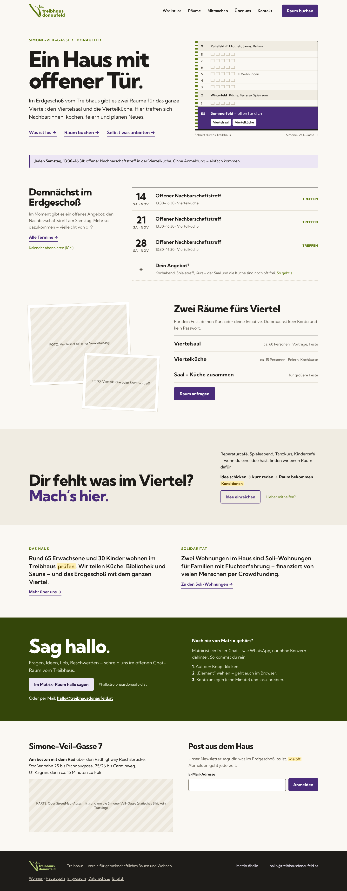

# Design – neue Website Treibhaus Donaufeld

Designentwürfe vom November 2026 für die neue Website mit Raumbuchung. Ausgangspunkt ist das [Briefing](briefing.md), umgesetzt wird nach dem [Implementierungsplan](../docs/implementierungsplan.md).

## Vorschau

| Seite | Hell | Dunkel |
| --- | --- | --- |
| Startseite (Desktop) | [start-desktop-hell.png](screenshots/start-desktop-hell.png) | [start-desktop-dunkel.png](screenshots/start-desktop-dunkel.png) |
| Startseite (Handy) | [start-handy-hell.png](screenshots/start-handy-hell.png) | [start-handy-dunkel.png](screenshots/start-handy-dunkel.png) |
| Angebote & Termine | [angebote-hell.png](screenshots/angebote-hell.png) | [angebote-dunkel.png](screenshots/angebote-dunkel.png) |
| Raumdetail Viertelsaal | [raum-viertelsaal-hell.png](screenshots/raum-viertelsaal-hell.png) | [raum-viertelsaal-dunkel.png](screenshots/raum-viertelsaal-dunkel.png) |
| Buchen 1–3: Raum, Zeit, Angaben | [buchen-1-hell.png](screenshots/buchen-1-hell.png) | [buchen-1-dunkel.png](screenshots/buchen-1-dunkel.png) |
| Buchen 4–5: Bestätigen per E-Mail oder Matrix | [buchen-2-hell.png](screenshots/buchen-2-hell.png) | [buchen-2-dunkel.png](screenshots/buchen-2-dunkel.png) |
| Buchen 6–8: Anfrage, Freigabe, Storno | [buchen-3-hell.png](screenshots/buchen-3-hell.png) | [buchen-3-dunkel.png](screenshots/buchen-3-dunkel.png) |
| Logo & Farben | [logo-und-farben.png](screenshots/logo-und-farben.png) | – |
| Sitemap & Inhaltsmodell | [sitemap-inhaltsmodell.png](screenshots/sitemap-inhaltsmodell.png) | – |
| Sequenz Verifizierung & Freigabe | [sequenz-verifizierung.png](screenshots/sequenz-verifizierung.png) | – |

## Farben

| Rolle | Wert | Verwendung |
| --- | --- | --- |
| Primär · Grün | `#5D7A10` | Logo, Links, Icons |
| Sekundär · Holunder | `#4A2C7A` | Buttons (immer mit weißer Schrift), Hervorhebungen |
| Sekundär · Holunderblüte | `#ECE6F4` | Helle Flächen und Hinweise, immer mit dunkler Schrift |
| Moos (abgeleitet) | `#34460A` | Dunkles Band „Sag hallo“ |
| Tinte | `#1E1C19` | Text |
| Stein | `#5F5A50` | Nebentext |
| Papier | `#FAF8F3` | Seitenhintergrund |
| Sand | `#F0ECE2` | Abschnitte |

Dunkelmodus: Hintergrund `#151410`, Logo in `#B9D27A`, Buttons in `#B7A2DC` mit dunkler Schrift. Alle Werte stehen als CSS-Variablen (`.th` und `.th.dark`) am Anfang jeder Seitendatei in [`canvas/`](canvas/).

Schrift: **Kumbh Sans** (OFL) für alles – ExtraBold 800 für Überschriften, Regular 400 ab 16 px für Text. Auf der Website selbst gehostet.

## Logo

- [`logo/logo-gruen.png`](logo/logo-gruen.png) – Primärgrün `#5D7A10`, für helle Hintergründe
- [`logo/logo-hell-dunkelmodus.png`](logo/logo-hell-dunkelmodus.png) – Hellgrün `#B9D27A`, für den Dunkelmodus
- [`logo/logo-original.png`](logo/logo-original.png) – Vorlage in der bisherigen Farbe
- [`logo/bildmarke.svg`](logo/bildmarke.svg) – nur die Bildmarke (Strich und Blätter) als Vektor, aus `logo-gruen.png` nachgezeichnet. Grundlage für das Favicon (`public/favicon.svg`, wechselt im Dunkelmodus auf `#B9D27A`), `favicon.ico`, `favicon-*.png` (transparent) und `apple-touch-icon.png` (helle Marke auf Primärgrün, weil iOS keine Transparenz kann).

## Quelldateien

[`canvas/`](canvas/) enthält die Artboards aus dem Design-Canvas (`.dc.html`) und dessen Anordnung (`canvas.json`, inklusive der Notizzettel mit offenen Entscheidungen). Die Dateien brauchen die Laufzeit des Canvas-Editors und lassen sich nicht direkt im Browser öffnen. Bilder sind dort als `/_blob/<id>` eingebunden:

| Blob-ID | Datei |
| --- | --- |
| `9c862de336f75ebbdcf0bf662cef7bf0` | `logo/logo-gruen.png` |
| `6214bc0246f1fd3f4e571e51857bbb22` | `logo/logo-hell-dunkelmodus.png` |

Die Vorschaubilder wurden aus diesen Dateien mit Playwright gerendert. Die Dunkel-Artboards (`*-dunkel.dc.html`) und `Start-Mobil.dc.html` binden nur die hellen Seiten mit anderem Modus bzw. schmaler Breite ein.

## Platzhalter

- Gelb markierter Text = offener Punkt (`TODO`), nichts davon ist erfunden.
- Gestreifte Flächen = Foto-Platzhalter mit Beschreibung des Motivs.
- Die Unterseiten Angebote, Raumdetail und Buchen Schritt 1 zeigen noch mehr Räume und Angebote als aktuell vorhanden. Aktuell offen sind nur Viertelsaal, Viertelküche und der Samstagstreff – so wie auf der Startseite.
