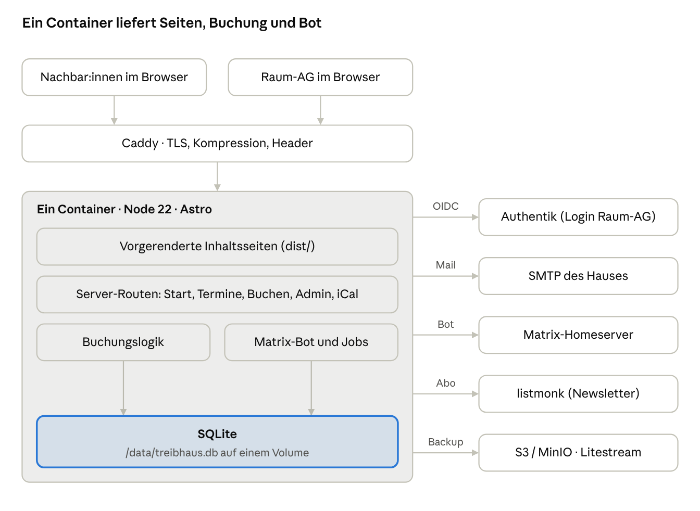
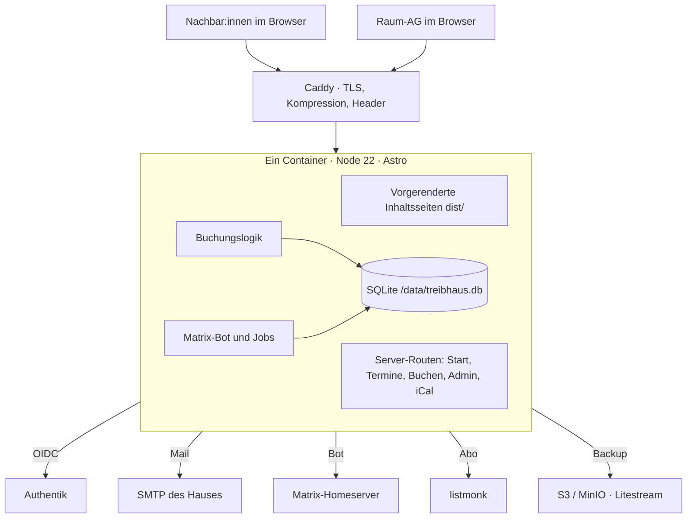

# Treibhaus Donaufeld – Implementierungsplan Website & Raumbuchung

Stand: 12. November 2026 · Fabian

## Kurzfassung

Ich empfehle **eine einzige Astro-Anwendung im Server-Modus (Node) mit SQLite**. Die Inhaltsseiten werden beim Build fertig gerendert und als statische Dateien ausgeliefert. Nur Buchung, Verifizierung, Admin-Bereich und Kalender-Feeds laufen dynamisch.

Alles läuft in **einem Container**: Webserver, Buchungslogik, Matrix-Bot und Hintergrundjobs in einem Node-Prozess, die Daten in einer SQLite-Datei auf einem Volume. Die Raum-AG meldet sich über Authentik an, Buchende brauchen kein Konto.

Der bestehende Astro-Neubau und die Inhalte als Markdown bleiben erhalten. Neu ist, dass die Seite nicht mehr auf GitHub Pages laufen kann, sondern einen kleinen Server braucht.

## Technologie-Empfehlung

Astro bleibt die Basis, weil Inhaltsseiten, Content Collections und das Design schon darauf aufbauen. Mit dem Node-Adapter wird daraus ein kleiner Server, der die Buchung gleich mitliefert. TypeScript im ganzen Projekt, eine Sprache für Seiten, API und Bot.

| Baustein | Wahl | Warum |
| --- | --- | --- |
| Web-Framework | Astro 5 mit `@astrojs/node` (standalone); Inhaltsseiten vorgerendert, Buchungsrouten mit `prerender = false` | Bestehender Neubau bleibt, im Browser kaum JavaScript |
| Formulare und API | Astro Actions plus einzelne API-Routen | Formulare funktionieren auch ohne JavaScript; Validierung mit Zod eingebaut |
| Datenbank | SQLite im WAL-Modus über `better-sqlite3` | Eine Datei, kein Datenbankserver; Transaktionen verhindern Doppelbuchungen |
| Datenzugriff | Drizzle ORM plus drizzle-kit | Typisiert, nah an SQL, Migrationen als Dateien im Repo |
| Interaktive Teile | Wenige Svelte-Inseln, z. B. Zeitwahl | Alles andere wird auf dem Server gerendert |
| E-Mail | Nodemailer über das SMTP des Hauses | Bestehende Infrastruktur |
| Matrix | `matrix-bot-sdk` im selben Prozess | Einladung, Direktnachricht, Meldungen im Raum-AG-Raum |
| Login Raum-AG | OIDC gegen Authentik (`openid-client`) | SSO über auth.treibhausdonaufeld.at, Zugriff per Gruppe |
| Kalender | `ical-generator`, `rrule` | iCal-Feeds und wiederkehrende Buchungen |
| Hintergrundjobs | Scheduler im Prozess, z. B. `croner` | Vorläufige Reservierungen auslaufen lassen, Daten löschen |
| Inhaltspflege | Decap CMS mit Git-Backend | Inhalte bleiben Markdown im Repo |

**Verworfene Alternativen:**

- **Python/FastAPI plus SQLite** (Vorschlag aus dem Briefing): solide, aber eine zweite Anwendung neben Astro. Das widerspricht dem Wunsch, dass die Homepage alles enthält.
- **PocketBase** (Go, SQLite, Admin-Oberfläche und Login eingebaut, liefert die statische Astro-Seite mit aus): sehr schlank. Die Buchungslogik läge aber in JS-Hooks einer Software vor Version 1.0, und ein Matrix-Bot mit dauerhafter Sync-Verbindung passt schlecht hinein. Gute Option, falls eine fertige Admin-Oberfläche wichtiger ist als eine Codebasis.
- **SvelteKit oder Next.js**: technisch möglich, würde aber den bestehenden Astro-Bau ohne Mehrwert ersetzen.

**Fertige Raumbuchungssysteme:** LibreBooking (PHP, MySQL), Easy!Appointments (Termine je Dienstleister) und Cal.com (Personenkalender, PostgreSQL) sind nach meinem Stand auf angemeldete Nutzer:innen oder einen anderen Anwendungsfall ausgelegt. Keines bietet Buchen ohne Konto, Bestätigung per Matrix und SQLite. Am nächsten kommt LibreBooking mit Freigaben, Serien und Pufferzeiten. Der Umbau auf unseren kontolosen Ablauf wäre aber aufwändiger als der eigene Buchungsteil. Das sollte vor der Entscheidung noch einmal kurz geprüft werden.

## Architektur

Alles läuft in einem Node-Prozess hinter Caddy; nach außen spricht er nur mit Diensten, die das Haus schon betreibt.





Inhaltsseiten kommen fertig aus dem Build. Startseite, Termine, Buchung, Admin und Feeds rendert der Server bei jeder Anfrage aus SQLite. Bot und Hintergrundjobs teilen sich Prozess und Datenbank mit dem Webserver, dadurch gibt es keine zweite Anwendung und keine Warteschlange.

## Datenmodell

Neun Tabellen in einer SQLite-Datei reichen. Alle Zeiten werden in UTC gespeichert und in Europe/Vienna angezeigt. Personenbezogene Daten stehen nur in `bookings` und `verifications` und werden nach der Löschfrist entfernt.

| Tabelle | Wichtige Felder | Zweck |
| --- | --- | --- |
| `rooms` | slug, name, Kapazität, Pufferzeit, Auto-Freigabe ja/nein, `combines` (Liste von Räumen) | Viertelsaal, Viertelküche und „Saal + Küche“ als kombinierter Raum, der beide belegt |
| `bookings` | Status, Raum, Zweck, Art (privat / gemeinnützig / kommerziell), Personenzahl, öffentlich ja/nein, Name, Kontaktweg + Adresse, Hausregeln akzeptiert am, Haltefrist, entschieden von/am, Notiz, Hash des Verwaltungslinks, Löschdatum | Eine Anfrage, auch eine Serie |
| `slots` | Buchung, Raum, Beginn, Ende, Ende inkl. Puffer | Jede belegte Zeit je Raum; Serien und Raumkombinationen erzeugen mehrere Zeilen. Hier läuft die Überschneidungsprüfung |
| `series` | Buchung, Regel (RRULE), bis wann | Wiederkehrende Buchungen, z. B. wöchentlicher Kurs |
| `blocks` | Raum (oder alle), Beginn, Ende oder Regel, Grund | Sperrzeiten: Nachtruhe, Hausversammlungen |
| `verifications` | Buchung, Kanal, Hash von Code und Link, läuft ab am, Versuche, bestätigt am | Bestätigung per E-Mail oder Matrix |
| `audit_log` | Zeitpunkt, wer (Authentik-Name, „System“, „Bot“), Aktion, Buchung, Details | Nachvollziehbar, wer was freigegeben hat |
| `trusted_contacts` | Hash der Kontaktadresse, Anzahl freigegebener Buchungen, vertraut ja/nein | Optionale Auto-Freigabe für Bekannte, ohne Klartext zu speichern |
| `rate_limits` | Schlüssel (Hash von IP oder Kontakt), Zeitfenster, Zähler | Spamschutz ohne Captcha |

Sessions der Raum-AG liegen ebenfalls in SQLite oder als signiertes Cookie. Eigene Admin-Konten gibt es nicht, Authentik liefert Name und Gruppe.

## Buchungslogik

Eine Anfrage blockiert den Raum erst, wenn die Person ihren Kontakt bestätigt hat. Ab dann ist sie „vorläufig“, bis die Raum-AG entscheidet oder die Haltefrist abläuft.

| Zustand | Bedeutung | Blockiert den Raum |
| --- | --- | --- |
| unbestätigt | Formular abgeschickt, Code unterwegs | nein, verfällt nach X Minuten |
| vorläufig | Kontakt bestätigt, wartet auf Freigabe | ja, bis zur Haltefrist |
| bestätigt | Raum-AG oder Auto-Freigabe hat angenommen | ja |
| abgelehnt / storniert / abgelaufen | Endzustände | nein |

1. **Doppelbuchung verhindern:** Beim Absenden und noch einmal bei der Bestätigung prüft eine SQLite-Transaktion (`BEGIN IMMEDIATE`) die neuen Slots gegen alle vorläufigen und bestätigten Slots und gegen Sperrzeiten. SQLite erlaubt nur einen Schreiber gleichzeitig, das macht die Prüfung sicher.
2. **Pufferzeiten:** Jeder Raum hat eine Pufferzeit, die an das Ende jedes Slots angehängt wird. Der Puffer zählt bei der Prüfung mit, im öffentlichen Kalender aber nicht als eigene Buchung.
3. **Saal + Küche:** Der kombinierte Raum legt einen Slot pro beteiligtem Raum an. Ist einer der beiden belegt, ist die Kombination belegt.
4. **Serien:** Die Regel wird für einen festen Zeitraum in einzelne Slots aufgelöst, z. B. bis Semesterende. Konflikte einzelner Termine sieht die Raum-AG vor der Freigabe. Serien werden nie automatisch freigegeben.
5. **Haltefrist:** Ein Job prüft jede Minute, ob vorläufige Anfragen abgelaufen sind. Dann wird der Slot frei und die Person bekommt Bescheid.
6. **Vorrang für Bewohner:innen:** Die Raum-AG kann im Admin-Bereich intern buchen und eine Anfrage übersteuern. Das verlangt eine Notiz und benachrichtigt die Betroffenen. Die genaue Regel legt die Hausgemeinschaft fest.
7. **Öffentliche Termine:** Bestätigte Buchungen mit „Offen für alle“ erscheinen im Terminkalender, auf der Startseite und im iCal-Feed.
8. **Verfügbarkeit:** Der öffentliche Kalender zeigt nur „frei“, „angefragt“, „belegt“ und „gesperrt“, nie Namen oder Zwecke.

## Verifizierung und Freigabe

Beide Wege senden dasselbe: einen 6-stelligen Code und einen Bestätigungslink. Code und Link-Token werden nur als HMAC-Hash gespeichert, gelten X Minuten und erlauben 3 Versuche.

**Per E-Mail:** Nodemailer schickt eine schlichte Text- und HTML-Mail über das SMTP des Hauses. Der Link führt auf `/buchen/bestaetigen?t=…` und bestätigt direkt.

**Per Matrix:** Der Bot `@raeume:treibhausdonaufeld.at` ist ein eigenes Konto auf dem Hausserver. Er öffnet einen Direktnachrichten-Raum mit der angegebenen Matrix-ID, lädt ein und schickt Code und Link, sobald die Einladung angenommen ist.

- **Anpassung am Design:** Matrix hat keine Knöpfe, die alle Apps anzeigen. Der „Bestätigen“-Knopf aus dem Entwurf wird deshalb ein Link. Zusätzlich kann der Bot eine Antwort mit dem Code in der Direktnachricht akzeptieren.
- **Verschlüsselung:** Der Bot legt den Raum unverschlüsselt an, sonst bräuchte er eine eigene Krypto-Verwaltung. Die Nachricht enthält nur Raum, Zeit und Code.
- **Matrix-ID nicht erreichbar:** Kommt die Einladung nicht an, zeigt die Seite den Fehler aus dem Entwurf und bietet E-Mail an.

**Freigabe durch die Raum-AG:** Nach der Bestätigung meldet der Bot die Anfrage im internen Raum-AG-Raum, mit Kurzinfo und Link in den Admin-Bereich. Entschieden wird im Admin-Bereich, damit jede Freigabe mit Namen im Audit-Log steht. Annehmen per Matrix-Reaktion kann später dazukommen, der Bot ordnet die Reaktion dann der Matrix-ID zu.

**Admin-Bereich `/admin`:** Login über Authentik (OIDC), Zugriff nur für die Gruppe `raum-ag`. Er enthält:

- offene Anfragen mit Annehmen und Ablehnen samt Notiz
- Kalender aller Räume, interne Buchungen, Sperrzeiten
- Export als CSV und iCal
- Statistik: Nutzungsstunden pro Raum und Art, für Förderberichte

**Bestätigung an die Buchenden:** über denselben Weg wie die Anfrage. Die Mail hängt eine `.ics`-Datei an, die Matrix-Nachricht verlinkt sie. Dazu kommen Zugangsinfos und der Verwaltungslink für Storno.

## Inhalte, CMS und Termine

Texte und Bilder leben als Markdown im Repo, alles mit Datum oder Belegung lebt in SQLite. So gibt es für jede Information genau eine Quelle.

| Was | Wo gepflegt | Wer |
| --- | --- | --- |
| Seiten, Angebotsbeschreibungen, Partner | Content Collections (Markdown), Decap CMS unter `/cms` | Redaktion, über Git |
| Raumbeschreibung, Fotos, Hausregeln | Content Collection `rooms`, per slug mit der Datenbank verknüpft | Redaktion |
| Kapazität, Puffer, Auto-Freigabe, Sperrzeiten | Admin-Bereich, SQLite | Raum-AG |
| Termine (auch der Samstagstreff) | Als öffentliche Serie im Admin-Bereich angelegt, SQLite | Raum-AG |

- **Startseite und Terminseite** werden auf dem Server gerendert und 60 Sekunden zwischengespeichert. So stehen die nächsten Termine ohne JavaScript im Browser direkt auf der Seite. Alle anderen Inhaltsseiten bleiben vorgerendert.
- **iCal-Feeds:** `/termine.ics` für alle öffentlichen Termine, `/raeume/<slug>.ics` mit anonymer Belegung, dazu eine `.ics` pro Buchung.
- **Kurz-URLs** wie `/buchen`, `/termine`, `/treff` und `/hallo` sind Weiterleitungen in der Astro-Konfiguration.
- **Englisch:** Astro-i18n mit Pfad `/en/`, zum Start nur die Kernseiten.
- **Newsletter:** Das Formular schickt die Adresse über den Server an die öffentliche Abo-Schnittstelle von listmonk. So bleibt die listmonk-Adresse unsichtbar und Spamschutz greift.
- **Inhaltsänderungen** lösen einen Build aus. Bis sie online sind, dauert es einige Minuten. Buchungen und Termine sind sofort sichtbar.

## Datenschutz und Sicherheit

Gespeichert wird nur, was für die Buchung nötig ist, und nach der Löschfrist automatisch entfernt. Die Seite setzt keine Tracker und lädt nichts von fremden Servern.

- **Datensparsam:** Name, Kontakt, Zweck, Personenzahl, Art. Keine Adresse, keine Telefonnummer.
- **Automatische Löschung:** Ein nächtlicher Job anonymisiert Buchungen X Monate nach dem Termin. Raum, Zeit, Art und Personenzahl bleiben für die Statistik, Name und Kontakt werden gelöscht. Unbestätigte Anfragen verschwinden nach 24 Stunden.
- **Tokens:** Codes, Bestätigungs- und Verwaltungslinks sind zufällig, nur als HMAC-Hash gespeichert und laufen ab.
- **Spamschutz ohne Captcha:** Honeypot-Feld, Mindestzeit zum Ausfüllen, Rate-Limit pro IP und pro Kontakt. Friendly Captcha kann optional dazukommen.
- **Formulare:** Astro Actions prüfen die Herkunft der Anfrage (Schutz gegen CSRF). Alle Eingaben werden mit Zod validiert.
- **Admin:** nur über Authentik, Sessions als `HttpOnly`-, `Secure`- und `SameSite`-Cookie. Jede Entscheidung landet im Audit-Log.
- **Keine fremden Ressourcen:** Kumbh Sans liegt selbst gehostet im Projekt, die Karte ist ein statisches OpenStreetMap-Bild.
- **Sicherheits-Header** (Content-Security-Policy, HSTS) setzt der Reverse-Proxy oder die Astro-Middleware.

## Betrieb

Ein Container-Image, eine Instanz, ein Volume für `/data`. Wegen SQLite läuft immer genau eine Instanz; bei Updates wird sie ersetzt, nicht parallel gestartet.

- **Image:** mehrstufiger Build auf `node:22-slim` (wegen des nativen `better-sqlite3`). Stufe 1 baut Astro, Stufe 2 enthält nur `dist/`, Produktionsabhängigkeiten und die Migrationen.
- **Start:** Migrationen laufen beim Start automatisch, danach startet der Server mit Bot und Jobs.
- **Daten auf `/data`:** `treibhaus.db` sowie der Zustand des Matrix-Bots.
- **Backup:** Litestream spiegelt die Datenbank laufend in einen S3-Bucket, z. B. MinIO. Zusätzlich schreibt ein nächtlicher Job einen Snapshot mit `VACUUM INTO`. Die Wiederherstellung sollte vor dem Start einmal geübt werden.
- **Reverse-Proxy:** Caddy vor dem Container kümmert sich um TLS, Kompression und Sicherheits-Header.
- **Deployment:** Docker Compose auf einem kleinen Server reicht. Alternativ im bestehenden Kubernetes mit einem Replica und Update-Strategie `Recreate`, ausgerollt per GitOps.
- **Konfiguration über Umgebungsvariablen:** `PUBLIC_URL`, `SMTP_*`, `MATRIX_HOMESERVER`, `MATRIX_BOT_TOKEN`, `MATRIX_ADMIN_ROOM`, `OIDC_ISSUER`, `OIDC_CLIENT_ID`, `OIDC_CLIENT_SECRET`, `SESSION_SECRET`, `HMAC_SECRET`, `LISTMONK_URL`.
- **Überwachung:** `/health` prüft Datenbank, SMTP und Matrix-Verbindung. Logs gehen strukturiert auf stdout. Abhängigkeiten aktualisiert Renovate.

## Projektstruktur

Ein Repo, das den bestehenden Astro-Neubau erweitert. Buchungslogik liegt in `src/lib/booking` und kennt weder Astro noch Matrix, damit sie sich allein testen lässt.

```
treibhaus-web/
├─ astro.config.mjs        Node-Adapter, i18n, Weiterleitungen
├─ drizzle/                Migrationen
├─ public/                 Fonts, Logos, Bilder
├─ src/
│  ├─ content/              pages, offers, rooms, partners (Markdown)
│  ├─ pages/
│  │  ├─ index.astro         Startseite, serverseitig
│  │  ├─ termine/            Liste, Kalender, termine.ics
│  │  ├─ raeume/[slug].astro Raumdetail mit Wochenansicht
│  │  ├─ buchen/             Schritte 1–4, bestätigen
│  │  ├─ b/[token].astro     Buchung verwalten, Storno
│  │  ├─ admin/              Raum-AG, OIDC-Login
│  │  └─ health.ts
│  ├─ actions/              Formulare (Astro Actions)
│  ├─ lib/
│  │  ├─ db/                 Schema, Verbindung
│  │  ├─ booking/            Zustände, Konflikte, Serien, Puffer
│  │  ├─ verify/             Codes, Tokens, Rate-Limit
│  │  ├─ notify/             mail.ts, matrix.ts
│  │  ├─ auth/               OIDC gegen Authentik
│  │  └─ ical/
│  ├─ jobs/                 Haltefrist, Löschung, Backup-Snapshot
│  ├─ components/           Header, Hausschnitt, Terminliste …
│  └─ styles/tokens.css     Farben hell und dunkel, Kumbh Sans
├─ tests/                  Vitest (Logik), Playwright (Buchungsablauf)
├─ Dockerfile
└─ compose.yaml
```

Die Farb-Tokens aus dem Design (`--primary`, `--brand`, `--band` …) werden 1:1 als CSS-Variablen übernommen, inklusive Dunkelmodus über `prefers-color-scheme` und Umschalter.

## Umsetzung in Phasen

Sieben Phasen mit grob geschätzt 21 bis 30 Personentagen. Nach Phase 2 kann die neue Seite schon online gehen, die Buchung folgt dann stückweise.

1. **Fundament (2–3 Tage):** Astro auf den Node-Adapter umstellen, SQLite und Drizzle einrichten, Dockerfile, Caddy, Deployment-Pipeline, Farb-Tokens als CSS-Variablen. Ergebnis: Die bestehende Seite läuft vom eigenen Server.
2. **Inhaltsseiten nach Design (4–6 Tage):** Startseite, Termine, Räume, Mitmachen, Über uns, Wohnen, Kontakt, Impressum, Datenschutz. Dazu Dunkelmodus, Kurz-URLs, Newsletter-Formular und Decap CMS. Ergebnis: Neue Seite ist live; „Raum anfragen“ verweist vorerst auf Matrix und E-Mail.
3. **Buchung, Kern (5–7 Tage):** Wochenansicht der Verfügbarkeit, Formular in vier Schritten, Bestätigung per E-Mail, Zustände, Konfliktprüfung, Haltefrist, Verwaltungslink mit Storno, alle Fehlerzustände aus dem Entwurf.
4. **Admin für die Raum-AG (3–4 Tage):** Login über Authentik, offene Anfragen, Annehmen und Ablehnen, Audit-Log, Sperrzeiten, interne Buchungen, CSV- und iCal-Export, Statistik.
5. **Matrix (3–4 Tage):** Bot-Konto, Bestätigung per Direktnachricht, Meldungen im Raum-AG-Raum.
6. **Termine und Serien (2–3 Tage):** Wiederkehrende Buchungen, öffentliche Termine auf Start- und Terminseite, iCal-Feeds. Der Samstagstreff wird als erste Serie angelegt.
7. **Feinschliff und Start (2–3 Tage):** Barrierefreiheit nach WCAG 2.2 AA prüfen (axe, Tastatur, Screenreader), Playwright-Tests für den Buchungsablauf, Backup wiederherstellen üben, Testlauf mit der Raum-AG.

Die Schätzung gilt für eine Person, die Astro und TypeScript kennt. Wartezeiten auf Entscheidungen der Hausgemeinschaft sind nicht eingerechnet.

## Offene Entscheidungen und Risiken

Vor Phase 1 müssen nur die technischen Punkte geklärt sein. Die Punkte der Hausgemeinschaft werden erst ab Phase 3 gebraucht und können bis dahin als Einstellungen mit Platzhalterwerten laufen.

**Technisch, vor dem Start:**

- [x] Wo läuft der Container: eigener kleiner Server mit Docker Compose oder das bestehende Kubernetes?
- [ ] Git-Hosting für Decap CMS: GitHub mit OAuth-App oder ein eigener Gitea?
- [ ] Umzug der Domain von GitHub Pages auf den neuen Server
- [ ] Authentik: Anwendung für die Website anlegen, Gruppe `raum-ag`
- [ ] Matrix: Bot-Konto `@raeume`, interner Raum-AG-Raum, Raum `#hallo`
- [ ] SMTP-Zugang für Absender `hallo@treibhausdonaufeld.at`
- [ ] S3-Bucket für Litestream-Backups

**Hausgemeinschaft, bis Phase 3:**

- [ ] Haltefrist für vorläufige Anfragen und Antwortzeit der Raum-AG
- [ ] Gültigkeit des Codes und Löschfrist der Buchungsdaten
- [ ] Pufferzeit pro Raum, Nachtruhe und weitere Sperrzeiten
- [ ] Auto-Freigabe: für wen und welche Zeiten
- [ ] Vorrang für Buchungen von Bewohner:innen
- [ ] Preise oder Spendenempfehlung, Hausregeln, Schlüsselübergabe

**Risiken:**

| Risiko | Folge | Gegenmaßnahme |
| --- | --- | --- |
| SQLite läuft nur als eine Instanz | Kein paralleler Betrieb, Ausfall bei Server-Problemen | Für diese Last ausreichend; Litestream-Backup und geübte Wiederherstellung |
| Matrix-Einladung kommt nicht an (andere Server, Filter) | Buchende hängen im Schritt 5b fest | Fehlermeldung mit Wechsel auf E-Mail, erneut senden |
| Spam über das Formular | Unnötige Arbeit für die Raum-AG | Honeypot, Rate-Limit, Prüfung erst nach Bestätigung des Kontakts |
| Wartung hängt an wenigen Ehrenamtlichen | Updates bleiben liegen | Kleiner Stack, Renovate, README für Betrieb und Inhaltspflege |
| Inhaltsänderungen brauchen einen Build | Änderungen erst nach Minuten online | Termine und Buchungen kommen aus der Datenbank und sind sofort sichtbar |
